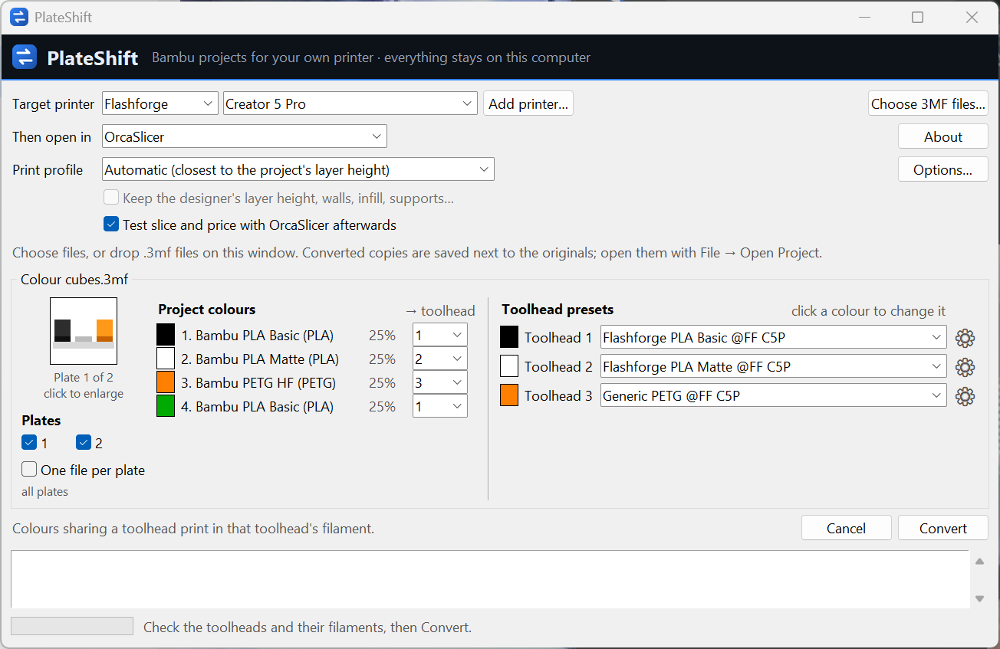
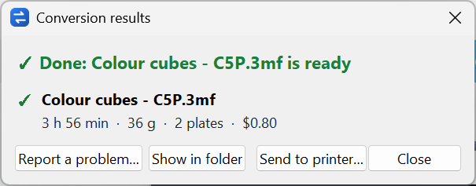

# PlateShift

Convert Bambu Studio and MakerWorld 3MF projects so they open ready to print on
another printer, entirely on your own PC. PlateShift never uses the internet: it
reads the printer profiles your slicer already installed and rewrites the project
file locally.

**Website and downloads: [cleland.co.za/PlateShift](https://cleland.co.za/PlateShift/)**

## Why PlateShift

- **Truly offline.** No uploads, no account, no analytics, no telemetry, not even an
  update check. Unplug the network and it works the same.
- **Never changes behind your back.** The version you run is the version you downloaded;
  a new one arrives only when you choose to download it.
- **Open source (AGPL), no ads.** Read every line, build it yourself, improve it. No ads,
  affiliate links or upsell.
- **Always-current profiles.** It uses the printer, print and filament profiles your
  slicer installed, including your own presets, rather than built-in copies that go
  out of date.
- **The right filament, not just the right material.** Each colour is matched to a real
  preset by name (Silk PLA stays Silk PLA), and it warns when two filaments need
  different nozzle temperatures on a one-nozzle printer.
- **The designer's model, your printer's limits.** Walls, infill, supports and layer
  height carry over; speeds and accelerations come from your printer's own profile.
- **Checked before you print.** An optional test slice proves the result slices and
  reports print time, filament weight and cost.
- **Many printers.** Flashforge and Creality out of the box, and **Add printer…** for
  anything else your slicers have profiles for.

| Pick a printer | Choose toolheads and filaments | Converted |
|---|---|---|
|  |  |  |

Built-in targets (more are mostly a matter of adding a line to
`plateshift/printers.py`). In the window, **Add printer…** adds any other printer
your slicers have profiles for (OrcaSlicer, Flash Studio or Creality Print): pick its
brand and model, and for a one-nozzle printer with a colour unit (AMS, CFS, MMU…) how
many slots it has.

| Key       | Printer                  | Colours at once | Profiles from |
|-----------|--------------------------|-----------------|---------------|
| `c5p`     | Flashforge Creator 5 Pro | 4 toolheads | Flash Studio or OrcaSlicer |
| `c5`      | Flashforge Creator 5     | 4 toolheads | Flash Studio or OrcaSlicer |
| `ad5x`    | Flashforge AD5X          | 4 IFS slots, one nozzle | Flash Studio or OrcaSlicer |
| `ad5m`    | Flashforge Adventurer 5M | 1 | Flash Studio or OrcaSlicer |
| `ad5mpro` | Flashforge Adventurer 5M Pro | 1 | Flash Studio or OrcaSlicer |
| `k1`, `k1c`, `k1se`, `k1max` | Creality K1, K1C, K1 SE, K1 Max | 1 | OrcaSlicer or Creality Print |
| `k1cfs`, `k1ccfs`, `k1secfs`, `k1maxcfs` | the same with the CFS | 4 CFS slots, one nozzle | OrcaSlicer or Creality Print |
| `k1c2025cfs`, `k1max2025cfs` | Creality K1C 2025, K1 Max 2025 with the CFS | 4 CFS slots, one nozzle | Creality Print |
| `k2`, `k2plus`, `k2pro`, `k2se` | Creality K2, K2 Plus, K2 Pro, K2 SE | 4 CFS slots, one nozzle | OrcaSlicer or Creality Print |
| `sparkxi7` | Creality SparkX i7 | 4 slots, one nozzle | OrcaSlicer or Creality Print |
| `sparkxi8` | Creality SparkX i8 | 4 slots, one nozzle | Creality Print |

On one-colour printers every colour prints in the one filament. On the AD5X and the
Creality CFS printers colours swap through one nozzle, so multi-colour prints take a
lot longer than on a toolchanger like the Creator 5. The K2 series assumes one CFS
(4 colours); projects with more colours are merged down to 4. The Creality K3 isn't
supported yet because no slicer ships a profile for it.

## Requirements

- Windows, Linux or macOS
- A slicer that has the printer's profiles: Flash Studio or OcraSlicer for the
  Flashforge printers, OrcaSlicer or Creality Print for the Creality ones. OrcaSlicer 2.4
  and later packs its profiles into `.opc` files; PlateShift reads those directly.
- On Windows, `PlateShift.exe`; on macOS, `PlateShift.app`. Both need nothing else
  installed. Running from source instead needs Python 3.11 or newer with Tk
  (standard library only, nothing to `pip install`).

## Windows

Download `PlateShift.exe` from the [latest release](https://github.com/viceroy172/PlateShift/releases/latest)
and run it. That's all: Python isn't needed. It isn't code-signed, so the first time
Windows SmartScreen may warn about it: choose **More info → Run anyway**.

`PlateShift.bat` in the source code is only for running PlateShift from source. That
needs Python 3.11 or newer from [python.org](https://www.python.org/downloads/windows/),
installed with **tcl/tk and IDLE** and the **py launcher** ticked (both are on by
default). If it can't find a suitable Python, `PlateShift.bat` says so and points you
back to the exe.

## Linux

Download `PlateShift-x86_64.AppImage` from the
[latest release](https://github.com/viceroy172/PlateShift/releases/latest), make it
executable and run it:

```
chmod +x PlateShift-x86_64.AppImage
./PlateShift-x86_64.AppImage                       # the window
./PlateShift-x86_64.AppImage convert "Model.3mf"   # or the command line
```

Some distros need FUSE 2 for AppImages (`sudo apt install libfuse2` on Ubuntu 22.04,
`libfuse2t64` on 24.04). Or run it from source:

```
sudo apt install python3 python3-tk        # Debian/Ubuntu; use your distro's equivalent
git clone https://github.com/viceroy172/PlateShift
cd PlateShift
./plateshift.sh                            # the window
./plateshift.sh convert "Model.3mf"        # or the command line
```

PlateShift looks for OrcaSlicer's profiles in `~/.config/OrcaSlicer/system` (and the
flatpak equivalent under `~/.var/app`). OrcaSlicer only puts a vendor there once
you've added one of its printers, so add your printer in OrcaSlicer first. If the
profiles live somewhere else, point PlateShift at them with `--profiles <folder>` or
the `PLATESHIFT_PROFILES` environment variable.

"Then open in" and the test slice find OrcaSlicer on your `PATH`, as a flatpak, or as
an AppImage in `~/Applications`, `~/Downloads`, `~/.local/bin` or `/opt`. Dropping files
on the window is Windows only; use **Choose 3MF files…** instead.

## macOS

Download `PlateShift-mac.zip` from the [latest release](https://github.com/viceroy172/PlateShift/releases/latest),
unzip it and drag `PlateShift.app` to Applications. The app isn't signed by Apple,
so the first time macOS won't open it:

1. Double-click PlateShift. macOS says it can't verify the app; click **Done**.
2. Open **System Settings → Privacy & Security**, scroll down to the message about
   PlateShift and click **Open Anyway**, then confirm.

On macOS 14 (Sonoma) and earlier you can instead right-click the app, choose **Open**,
then **Open** again. Or, in Terminal: `xattr -dr com.apple.quarantine /Applications/PlateShift.app`.

If macOS says PlateShift **is damaged**, you have a 0.4.3 or 0.4.4 download from before
21 November 2026, whose signature was broken. Download it again.

Or run it from source with Python 3.11+ from python.org (Homebrew's Python needs
`brew install python-tk` as well):

```
git clone https://github.com/viceroy172/PlateShift
cd PlateShift
./plateshift.sh
```

PlateShift finds Flash Studio, OrcaSlicer and Creality Print in your Applications
folder and reads their profiles from `~/Library/Application Support`, or from inside
the app if you haven't added the printer there yet. Drop `.3mf` files on PlateShift's
Dock icon, or use **Open With → PlateShift** in Finder; dropping onto the window
itself isn't possible on macOS.

The macOS build is tested automatically against the official OrcaSlicer for Mac, but
hasn't had much use on real Macs yet; reports are welcome.

## Use it

**Window:** run `PlateShift.exe` on Windows, `PlateShift.app` on macOS, or
`./plateshift.sh` on Linux (`PlateShift.bat` on Windows when running from source).
Pick the printer's brand and model, then choose files or drop them on the window.

For a single file you get a panel with the project's own picture of its first plate
(click it to see every plate full size, so you know it's the right file), the
project's colours and how much of the model each one paints. Put each colour on a
toolhead (two colours on one toolhead merges them) and pick a filament preset per
toolhead, including your own presets from Flash Studio and OrcaSlicer. The filament
you pick for a toolhead is remembered for that printer and offered first next time,
as long as the project needs the same material there. Click a toolhead's colour to change it
to your spool's colour (the last ten you used are kept for quick picking); this only
changes the colour the slicer shows, not what gets printed. Projects with more colours than the
printer has toolheads start with the closest colours already merged. Several files
at once are matched automatically.

Projects with more than one plate get a tick per plate: untick the ones you don't
want and the rest are renumbered from 1. Tick **One file per plate** to save each
plate as its own project (`Model - C5P - plate 2.3mf`). The enlarged plate pictures
have a *Convert this plate* tick too, so you can choose while you look.

Every dropdown takes type-ahead: type the first letters of an entry (or of any word in
it, so "silk" finds *Generic PLA Silk*) to jump there, type the same letter again to
step through its matches.

**Print profile** is Automatic by default: the slicer's own print preset with the
closest layer height, with the designer's choices put over it. Or pick one of your
own print profiles from Flash Studio, OrcaSlicer or Creality Print (marked *yours*) or
any of the slicer's. Then your profile wins: walls, infill, supports and so on come
from it, and only which filament prints what follows the project. Tick **Keep the
designer's layer height, walls, infill, supports…** to put the designer's choices over
your profile instead. A model can rely on the designer's settings (supports for
overhangs, or Classic walls for very thin parts), so if a test slice fails with your
profile, try ticking that box. The choice is remembered per printer.

**Test slice** runs Flash Studio for the Flashforge printers and OrcaSlicer for the
Creality ones (or OrcaSlicer wherever Flash Studio isn't installed) in the background
after converting, and adds the print time and filament weight to the report, or the
error if it won't slice. Creality Print can't slice from the command line, so testing a
Creality conversion needs OrcaSlicer.

**Price:** after the test slice the report shows what the print costs in filament, per
toolhead and in total, using each filament preset's own price per kg (*Filament cost*
in your slicer's filament settings). To use a different price, click the ⚙ beside the
filament: it turns blue, the price is remembered for that preset in every project, and
it goes into the converted file so the slicer shows the same cost. PlateShift only
reads your slicer's filament profiles; a price changed in PlateShift doesn't change the
profile (the slicer may show that filament as modified in the converted project). The
currency comes from your computer's regional settings and can be changed in the same
window.

**Options…** can put PlateShift in the *Open with* list for 3MF files (right-click a
file in Explorer or your file manager; your default app for 3MF files doesn't change;
on a Mac it's in Finder's Open With already), and can watch your Downloads folder
while PlateShift is open: when a 3MF file finishes downloading, from MakerWorld for
example, PlateShift comes forward with it ready to convert.

When a run ends, a small **results window** sums up each file: print time, filament
weight and cost, or what went wrong, with any warnings. **Report a problem…** there (and
in About) makes a zip of the last run's project files, the log and version details,
then opens a new GitHub issue for you to attach it to. Nothing is sent by itself.



**Send to printer…** (in the results window, after converting one file for a
Flashforge or Creality printer) sends the print straight to the printer on your
network. It uses the test slice's G-code, or slices the project first, and for a
project with several plates you pick the plate. It only uploads the file unless you
tick **Start printing now**, so check the bed is clear and the right filament is
loaded before you do.

- **Flashforge** (Creator 5, AD5X, Adventurer 5M): give the printer's IP address,
  serial number and check code (on its screen: the serial number under About, the
  check code where LAN mode is switched on). If Flash Studio has connected to the
  printer, PlateShift fills in the serial number and check code from it. Each filament goes to the slot or
  toolhead with the same number, and PlateShift warns when a slot holds a different
  material.
- **Creality** on stock firmware (K1 family, K2, SparkX): just the printer's IP
  address. No Helper Script or root access is needed.

Addresses and check codes are remembered on this computer only, and are left out of
problem reports.

**Then open in** opens a single converted file in a slicer that has the printer's
profiles: Flash Studio or OrcaSlicer for the Flashforge printers, Creality Print or
OrcaSlicer for the Creality ones. The choice is remembered per printer in
`%APPDATA%\PlateShift\settings.json` (`~/.config/plateshift/settings.json` on Linux and macOS).

**Command line:**

```
python -m plateshift inspect "Model.3mf"                      # colours, usage, suggested toolheads
python -m plateshift convert "Model.3mf"                      # -> "Model - C5P.3mf"
python -m plateshift convert "Model.3mf" -m "5=2,6=3"         # colour 5 -> toolhead 2, 6 -> 3
python -m plateshift convert "Model.3mf" -c 3=#2E7D32         # show toolhead 3 in your green
python -m plateshift convert "Model.3mf" --plates 1,3-4         # only these plates, renumbered 1-3
python -m plateshift convert "Model.3mf" --split                # a file per plate
python -m plateshift convert "Model.3mf" -f 1="FilX SBS @FF C5P" --test-slice
python -m plateshift convert "Model.3mf" -t --price "Generic PLA @FF C5P=350"   # your price, and the cost
python -m plateshift convert *.3mf --printer k1max -o converted\
python -m plateshift filaments --printer c5p                  # preset names, yours marked
python -m plateshift processes --printer c5p                  # print profiles, yours first
python -m plateshift convert "Model.3mf" --process "0.20mm Standard @FF C5P"   # your profile wins
python -m plateshift convert "Model.3mf" --process "0.20mm Standard @FF C5P" --keep-design
python -m plateshift printers
```

Open the result with **File → Open Project**. Importing it as a model leaves the
converted settings behind.

## What it changes

| Part of the project | What happens |
|---|---|
| Printer settings | Replaced by the target's system printer preset, start/end G-code included |
| Print settings | Taken from the print profile you pick, or by default the target process preset with the closest layer height. Then, unless your own pick wins, the project's design choices (layer height, walls, infill, supports, raft, brim, ironing, seam, fuzzy skin, which filament prints what, and line widths when the nozzle size matches) are carried over. Everything else comes from the target preset or the slicer's defaults. |
| Filaments | Each toolhead gets the closest target preset of the same material, matched on type and name (Basic, Silk, Matte, CF…), or the one you pick, and keeps the project's colour |
| Painted colours | Rewritten triangle by triangle when colours are merged or moved to another toolhead, along with each object's filament, layer colour changes and support filament |
| Models, per-object settings, plates | Copied unchanged, unless you leave plates out: then their objects, pictures and per-plate settings go and the rest are renumbered |
| Object positions | If the bed is a different size, objects and prime towers are moved so they stay where they were on their plate. A prime tower that would then run into an object is moved to the nearest clear spot. Anything that hangs off a plate, is too tall or leaves no room for the tower gets a warning |
| Sliced G-code | Removed, because it was made for the original printer |
| Bambu Studio 2.x extras | Per-nozzle-type lists are cut to the standard nozzle, `#D6B685FF` colours become `#D6B685`, Bambu-only options are dropped |
| Version label | Every file is labelled the way Flash Studio labels its own projects, so it opens them without a "newer 3MF version" warning |

The original file is never modified.

## Limits

- Your own printer presets are never used. They hold things like the printer's IP
  address and access key, which shouldn't end up in a project file. Your own print
  and filament profiles are fine to use.
- Your own Creality Print profiles are only offered when PlateShift is using Creality
  Print's printer profiles, which it does when OrcaSlicer isn't installed. They're built
  on Creality Print's preset names, which OrcaSlicer's profiles don't have.
- Creality projects use OrcaSlicer's profiles when OrcaSlicer is installed, otherwise
  Creality Print's. The two name the printer differently, so a project opened in the
  other slicer shows up as a project printer.
- Settings outside the carry-over list fall back to the target's values, so niche
  options the designer changed are left at their defualts.
- Only the 0.4 mm nozzle presets are targeted.
- OrcaSlicer's time estimate for the Creator 5 differs a lot from Flash Studio's;
  trust Flash Studio's for that printer.
- The test slice fails for the Creality K2 and SparkX i7: OrcaSlicer's own profiles for
  them set a cutter retraction its command line rejects as out of range. PlateShift
  leaves the printer's value as Creality set it.
- The K1C 2025, K1 Max 2025 and SparkX i8 are only in Creality Print, which can't
  slice from the command line, so they can't be test sliced.
- On the Creality CFS printers the prime tower is large (around 65 mm square), so a
  model that nearly fills the bed leaves no room for it. PlateShift warns when that
  happens.
- Check the first layer and supports in the the slicer before printing anything large.

## How it works

A 3MF project is a zip. `Metadata/project_settings.config` holds every slicer
setting as JSON, `Metadata/model_settings.config` holds objects and plates,
`3D/3dmodel.model` holds where each object sits and the `3D/Objects/*.model` files
hold the meshes, with painted colours stored per triangle as a small bit-packed tree
(`plateshift/paint.py`). PlateShift resolves the target presets through their
`inherits` chains (`plateshift/profiles.py`), reading OrcaSlicer's packed `.opc`
profile files itself where needed (`plateshift/opc.py`, written from the layout in
OrcaSlicer's `docs/HLSD/preset-cache.md`), builds new project settings and rewrites
the colours (`plateshift/convert.py`), checks fit (`plateshift/fit.py`) and writes a
new zip.

## Building the apps

```
py -3.11 -m venv .venv
.venv\Scripts\pip install pyinstaller
build_exe.bat
```

The result is `dist\PlateShift.exe`. Build with a Python that has Tk.

`PlateShift.app` is built on a Mac by the `macos` GitHub workflow (the `app` job), which
keeps it as a downloadable `PlateShift-mac` artifact.

## Tests

```
python -m unittest discover -s tests
```

The tests build small Bambu-style projects in code. One extra test runs against
the real Flashforge presets when Flash Studio or OrcaSlicer is installed.

PlateShift is not affiliated with Bambu Lab, Flashforge, Creality or MakerWorld.

## Contact

Bugs and ideas are best raised as [GitHub issues](https://github.com/viceroy172/PlateShift/issues).
For anything else, email viceroy@imaginet.co.za.

## Licence

Copyright (C) 2026 PlateShift contributors.

PlateShift is free software: you can redistribute it and/or modify it under the
terms of the GNU Affero General Public License as published by the Free Software
Foundation, either version 3 of the License, or (at your option) any later
version. It comes with no warranty. See `LICENSE` for the full terms.

The Windows and Mac apps also carry Python, Tcl/Tk and PyInstaller's launcher; their
licences are under **About → Licences…** in the app (generated by `tools/make_licences.py`).

Versions up to and including 0.4.4 were released under the MIT licence, and copies
of those versions keep it.
